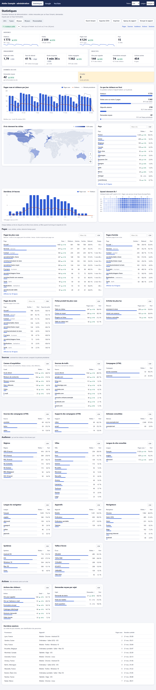

# stats-kit

Statistiques de fréquentation pour l'administration d'un site, prêtes à brancher :

- **serveur** (Node, sans framework imposé, intergiciel Express fourni) : connecteurs **Umami** (API v2 et v3, auto-hébergé ou Cloud), **Google Search Console** (compte de service ou OAuth) et **YouTube** (Data et Analytics, OAuth) ; périodes, comparaison avec la période précédente, direct, dernières 24 heures, carte de chaleur jour × heure, pages d'entrée et de sortie, géographie ; **rapport hebdomadaire** en HTML compatible Outlook (760 px, images jointes en `cid:`), carte du monde PNG dessinée côté serveur, aperçu, planification. L'envoi reste au site : la librairie n'envoie rien.
- **composants Angular** autonomes : page **Statistiques** complète, pages **Google** (Search Console) et **YouTube**, et leurs briques (tuiles, tableaux triables et exportables en CSV, graphiques, carte du monde SVG, carte de chaleur). Thème par variables CSS, clair et sombre, accessibles (WCAG 2.1 AA vérifié par axe-core), utilisables au téléphone, pleine largeur, sans aucun style global.
- **un contrat de données unique** (types TypeScript et schéma JSON, [docs/CONTRAT.md](docs/CONTRAT.md)) : un serveur écrit dans un autre langage (.NET…) peut renvoyer les mêmes réponses et utiliser les mêmes composants.

Textes en français et en anglais, tous remplaçables par les réglages du site. Aucune dépendance d'exécution côté serveur ; côté navigateur, seulement Angular.



Autres captures (données factices de la démo) : [sombre](captures/statistiques-sombre.png), [téléphone](captures/statistiques-telephone.png), [Google](captures/google.png), [YouTube](captures/youtube-sombre.png), [rapport par e-mail](captures/rapport.png), [anglais](captures/statistiques-anglais.png).

## Installation (sans registre npm)

Le paquet s'installe directement depuis Git. Deux possibilités, au choix :

```sh
# Version publiée : l'étiquette contient les paquets déjà construits (installation immédiate, recommandé)
npm i github:manueldelarque/stats-kit#v0.1.1

# Branche principale : les paquets sont construits à l'installation (script « prepare », une à deux minutes)
npm i github:manueldelarque/stats-kit
```

Dans un même ensemble de dépôts, un chemin fonctionne aussi : `npm i ../stats-kit` (lancer d'abord `npm install` dans `stats-kit`, qui construit les paquets). Avec un lien symbolique, Angular peut demander `"preserveSymlinks": true` dans les options de construction.

Le paquet expose trois points d'entrée : `stats-kit/serveur`, `stats-kit/angular` et `stats-kit/contrat` (types, textes, fonctions pures, schéma JSON sous `stats-kit/contrat/schema.json`). Node 22.18 ou plus récent ; Angular 21 ou plus récent.

Si le dépôt change de propriétaire, seule l'adresse ci-dessus change : rien d'autre dans le code ne la mentionne.

## Côté serveur (Express, dix lignes)

```ts
import express from 'express';
import { createStatsKit, sourcesFromEnv } from 'stats-kit/serveur';

const stats = createStatsKit({
  siteName: 'Mon site',
  timeZone: 'Europe/Paris',
  ...sourcesFromEnv(), // UMAMI_*, GSC_*, YOUTUBE_* (voir plus bas)
  report: { theme: { brand: '#1d3c9c' }, statsUrl: 'https://www.exemple.org/admin/statistiques', send: (m) => monEnvoi(m) },
});
app.use('/api/admin/audience', exigerAdmin, stats.middleware());
```

`monEnvoi(message)` reçoit `{ subject, html, text, attachments: [{ cid, filename, contentType, content }] }` et l'envoie par le moyen du site (nodemailer, API d'un prestataire…) ; elle renvoie le nombre de destinataires. Avec nodemailer : `attachments: m.attachments.map((a) => ({ cid: a.cid, filename: a.filename, contentType: a.contentType, content: Buffer.from(a.content) }))`.

L'intergiciel s'accroche aussi à `node:http`. Pour un autre framework, `stats.handle({ method, path, query })` renvoie `{ status, headers, body }`. Les méthodes `stats.overview()`, `stats.search()`, `stats.youtube()`, `stats.report()`, `stats.sendReport()` donnent les mêmes données sans passer par HTTP.

**Adresse de l'API** : éviter « analytics », « stats » ou « track » dans le chemin, que les bloqueurs de publicités bloquent (`/api/admin/audience` passe). **Protéger** les routes : elles exposent des données d'audience ; la librairie ne gère pas l'authentification.

Routes (relatives au point de montage) : `GET /overview`, `GET /live`, `GET /search`, `GET /search/indexation`, `GET /youtube`, `GET /report/preview`, `POST /report/send`, `GET /world.json`. Périodes : `?days=7` (1 = dernières 24 heures, jusqu'à 366) ou `?from=AAAA-MM-JJ&to=AAAA-MM-JJ`.

### Rapport hebdomadaire

```ts
import { startWeeklyReport } from 'stats-kit/serveur';

startWeeklyReport({
  schedule: { weekday: 1, hour: 8, timeZone: 'Europe/Paris' }, // le lundi à partir de 8 h
  getLastSent: () => maBase.lire('rapport.semaine'),           // « 2026-W47 » : une seule fois par semaine, même avec plusieurs instances
  setLastSent: (semaine) => maBase.écrire('rapport.semaine', semaine),
  send: async () => (await stats.sendReport({ days: 7 }, true)).ok,
});
```

L'aperçu (`GET /report/preview`) renvoie le message tel qu'il partirait, images incluses dans la page.

## Côté Angular (dix lignes)

```ts
// app.config.ts
providers: [provideHttpClient(), provideStatsKit({ apiUrl: '/api/admin/audience', locale: 'fr' })]

// une page de l'administration
import { SkStatistiques, SkSearchConsole, SkYoutube } from 'stats-kit/angular';
@Component({ imports: [SkStatistiques], template: `<sk-statistiques theme="auto" />` })
export class PageStatistiques {}
```

Les appels passent par `HttpClient` : les intercepteurs du site (jeton d'authentification…) s'appliquent. Entrées utiles :

| Composant | Entrées |
|---|---|
| `<sk-statistiques>` | `apiUrl`, `locale`, `texts`, `theme` (`auto`, `light`, `dark`), `presets` (`[1, 7, 30, 90]`), `initialDays`, `report` (boutons du rapport), `liveMs`, `refreshMs`, `worldUrl` |
| `<sk-search-console>` | `apiUrl`, `locale`, `texts`, `theme`, `presets` (`[7, 28, 90, 365]`), `initialDays` |
| `<sk-youtube>` | `apiUrl`, `locale`, `texts`, `theme`, `presets` (`[7, 28, 90]`), `initialDays` |

Les briques (`sk-tile-groups`, `sk-metric-table`, `sk-trend-chart`, `sk-world-map`, `sk-heatmap`) s'utilisent seules pour composer d'autres pages. La carte du monde est dessinée en SVG, sans Leaflet : pas de dépendance CommonJS, pas de feuille de style externe, aucun réglage `allowedCommonJsDependencies`.

Les styles d'une page restent sous 16 kB ; si le site a un budget `anyComponentStyle` plus serré, le relever à 16 kB.

## Réglages

### Sources (variables d'environnement lues par `sourcesFromEnv`)

| Source | Variables |
|---|---|
| Umami | `UMAMI_API_URL`, `UMAMI_WEBSITE_ID`, et `UMAMI_USERNAME` + `UMAMI_PASSWORD` (compte de service en lecture) ou `UMAMI_API_KEY` (Umami Cloud) ; `UMAMI_DASHBOARD_URL` (`false` pour masquer le bouton) |
| Search Console | `GSC_SITE` (« sc-domain:exemple.org »), `GSC_SERVICE_ACCOUNT` (clé JSON, brute ou en base64) ou `GSC_OAUTH` (`{client_id, client_secret, refresh_token}`), `GSC_SITEMAP_URL` (vérification d'indexation) |
| YouTube | `YOUTUBE_CLIENT_ID`, `YOUTUBE_CLIENT_SECRET`, `YOUTUBE_REFRESH_TOKEN` (propriétaire de la chaîne), `YOUTUBE_CHANNEL_ID` (chaîne attendue), `YOUTUBE_CHANNEL_URL` |

Une source sans réglage est annoncée « non configurée » ; une source qui ne répond pas est annoncée « indisponible » sans empêcher le reste de s'afficher. Les réglages peuvent aussi être passés directement (`umami: { url, websiteId, username, password }`…).

Umami ignore les navigateurs sans interface (headless) : pour vérifier le comptage réel, ouvrir le site dans un vrai navigateur.

### Données du site

```ts
createStatsKit({
  // …
  pages: {
    languages: ['fr', 'en'],                         // /fr/contact et /en/contact comptent pour /contact
    labels: { '/': 'Accueil', '/contact': 'Contact' },
    groups: [{ id: 'fiches', title: 'Fiches les plus vues', pattern: /^\/produits\/([a-z0-9-]+)$/ }],
  },
  events: { labels: { 'clic-telephone': 'Clic pour appeler' } },
  goals: [{ id: 'appels', label: 'Clics pour appeler', events: ['clic-telephone'] }],
  // Données de la base du site, affichées même si Umami ne répond pas (tuiles, tableaux, dernière étape de l'entonnoir) :
  extras: async (range) => ({ tiles: [/* … */], tables: [/* … */], funnel: { label: 'Demandes reçues', value: 12 } }),
  // Demandes enregistrées après une visite venue de YouTube (lien `utm_source=youtube`) :
  sourceRequests: async (from, to, source) => ({ total: 3, bySubject: [] }),
});
```

### Textes

Tous les textes (pages et rapport) viennent de `textes(langue, remplacements)` : français (`fr`) et anglais (`en`) fournis. Le site peut en remplacer n'importe lequel, côté serveur (`texts` de `createStatsKit`, pour le rapport) comme côté Angular (`texts` de `provideStatsKit` ou de chaque page) :

```ts
provideStatsKit({ apiUrl: '/api/admin/audience', texts: { stats: { title: 'Audience', lead: 'Visites du site, sans cookie.' } } });
createStatsKit({ /* … */ texts: { report: { intro: 'Bonjour,\nvoici le point de la semaine.', footer: 'Envoyé chaque lundi.' } } });
```

Pour une autre langue, fournir les textes complets avec `baseTexts` (même forme que `LANGUES.fr`).

## Thème

Le site définit les variables qu'il veut, sur n'importe quel ancêtre des composants (ou sur leur balise). Le mode sombre s'active par l'entrée `theme="dark"` (ou `auto`, qui suit le système), ou par `data-sk-mode="dark"` sur un ancêtre. Une variable définie par le site s'applique dans les deux modes : lui donner sa valeur sombre sous le sélecteur sombre du site.

```css
sk-statistiques, sk-search-console, sk-youtube {
  --sk-brand: #1d3c9c;     /* boutons, liens, focus */
  --sk-chart-1: #1d3c9c;   /* barres */
  --sk-chart-2: #c2410c;   /* courbe */
  --sk-radius: 10px;
  --sk-font: inherit;
}
html.sombre sk-statistiques { --sk-brand: #9ab6ff; --sk-chart-1: #7d9ef7; }
```

Variables disponibles : `--sk-card`, `--sk-bg`, `--sk-ink`, `--sk-ink-2`, `--sk-muted`, `--sk-line`, `--sk-line-strong`, `--sk-brand`, `--sk-on-brand`, `--sk-chart-1`, `--sk-chart-1-hover`, `--sk-chart-2`, `--sk-chart-3`, `--sk-up`, `--sk-up-soft`, `--sk-down`, `--sk-down-soft`, `--sk-warn`, `--sk-warn-soft`, `--sk-hover`, `--sk-bar-track`, `--sk-input`, `--sk-badge`, `--sk-map-sea`, `--sk-map-land`, `--sk-map-border`, `--sk-map-lo`, `--sk-map-hi`, `--sk-shadow`, `--sk-radius`, `--sk-gap`, `--sk-font`. Les valeurs par défaut respectent un contraste AA ; en les changeant, le site garde la main sur ce contraste.

Le rapport par e-mail a son propre thème : `report.theme = { brand, head, ink, muted…, font, display, logo: { png | url, width, alt } }` ; seule `brand` est nécessaire.

Toutes les classes des composants commencent par `sk-` et leurs styles sont encapsulés : les styles globaux du site (`svg { … }`, `.bar`, `.card`…) ne les atteignent pas, et réciproquement.

## Développement

```sh
npm install          # dépendances, puis construction des paquets
npm test             # serveur et contrat : Vitest, couverture (100 % des lignes)
npm run test:angular # composants : Vitest dans Angular, couverture (100 % des lignes)
npm run e2e          # démo construite puis Playwright (Chrome installé), accessibilité comprise
npm run demo:build && npm run demo   # démo sur http://localhost:5317, données factices
npm run captures     # captures de la démo dans captures/
npm run schema       # régénère le schéma JSON depuis les types
npm run exemples     # régénère les exemples de réponses (packages/contrat/exemples)
npm run publier      # construit et pousse l'étiquette v<version> avec les paquets construits
```

La démo (`demo/`) joue le rôle d'un site : elle a ses propres styles globaux, dont des règles volontairement hostiles, et sert de terrain aux tests de bout en bout. Les faux services (`demo/faux/services.ts`) imitent Umami, la Search Console et YouTube avec un trafic fictif et déterministe ; rien ne sort de la machine.

Migration des sites existants : [docs/MIGRATION.md](docs/MIGRATION.md).

## Licence

MIT, voir [LICENSE](LICENSE). Fond de carte : Natural Earth (domaine public).
