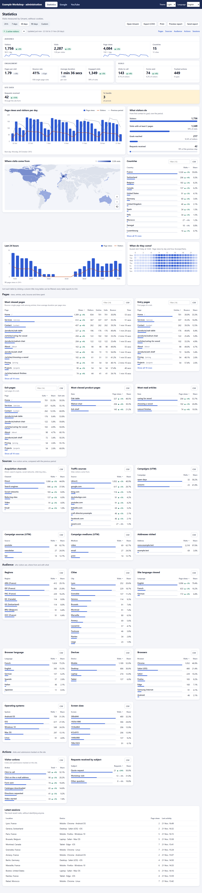

# stats-kit

Website traffic statistics for a site's administration, ready to plug in:

- **server** (Node, no framework imposed, Express middleware included): **Umami** connector (API v2 and v3, self-hosted or Cloud), **Google Search Console** (service account or OAuth) and **YouTube** (Data and Analytics, OAuth); periods, comparison with the previous period, live count, last 24 hours, day × hour heatmap, entry and exit pages, geography; **weekly report** in Outlook-compatible HTML (760 px, images attached as `cid:`), world map PNG drawn on the server, preview, scheduling. Sending stays with the site: the library sends nothing.
- **standalone Angular components**: a complete **Statistics** page, **Google** (Search Console) and **YouTube** pages, and their building blocks (tiles, sortable tables exportable to CSV, charts, SVG world map, heatmap). Themed with CSS variables, light and dark, accessible (WCAG 2.1 AA checked with axe-core), usable on a phone, full width, without any global style.
- **a single data contract** (TypeScript types and JSON schema, [docs/CONTRACT.md](docs/CONTRACT.md)): a server written in another language (.NET…) can return the same responses and use the same components.
- **labels in several languages** — English (default), French, German, Spanish, Italian, Portuguese and Dutch — in the pages, the e-mail report, its preview and the map; numbers, percentages, durations, dates, weekdays, country and language names follow the chosen locale (Intl). Any label can be overridden by the site.

No runtime dependency on the server; in the browser, only Angular.



More screenshots (fake demo data): [dark](screenshots/statistics-dark.png), [phone](screenshots/statistics-phone.png), [Google](screenshots/google.png), [YouTube](screenshots/youtube-dark.png), [e-mail report](screenshots/report.png), [French](screenshots/statistics-french.png), [German](screenshots/statistics-german.png).

## Installation (without an npm registry)

The package installs straight from Git. Two options:

```sh
# Released version: the tag contains the packages already built (immediate installation, recommended)
npm i github:manueldelarque/stats-kit#v0.2.0

# Main branch: the packages are built at installation ("prepare" script, one to two minutes)
npm i github:manueldelarque/stats-kit
```

Within a set of repositories, a path works too: `npm i ../stats-kit` (run `npm install` in `stats-kit` first, which builds the packages). With a symbolic link, Angular may need `"preserveSymlinks": true` in the build options.

The package exposes three entry points: `stats-kit/server`, `stats-kit/angular` and `stats-kit/contract` (types, texts, pure functions; JSON schema under `stats-kit/contract/schema.json`). Node 22.18 or later; Angular 21 or later.

If the repository changes owner, only the address above changes: nothing else in the code mentions it.

## Server side (Express, ten lines)

```ts
import express from 'express';
import { createStatsKit, sourcesFromEnv } from 'stats-kit/server';

const stats = createStatsKit({
  siteName: 'My site',
  timeZone: 'Europe/Paris',
  locale: 'en', // language of the report: en, fr, de, es, it, pt, nl, or a regional tag ("fr-CH")
  ...sourcesFromEnv(), // UMAMI_*, GSC_*, YOUTUBE_* (see below)
  report: { theme: { brand: '#1d3c9c' }, statsUrl: 'https://www.example.org/admin/statistics', send: (m) => mySend(m) },
});
app.use('/api/admin/audience', requireAdmin, stats.middleware());
```

`mySend(message)` receives `{ subject, html, text, attachments: [{ cid, filename, contentType, content }] }` and sends it the site's way (nodemailer, a provider's API…); it returns the number of recipients. With nodemailer: `attachments: m.attachments.map((a) => ({ cid: a.cid, filename: a.filename, contentType: a.contentType, content: Buffer.from(a.content) }))`.

The middleware also plugs into `node:http`. For another framework, `stats.handle({ method, path, query })` returns `{ status, headers, body }`. The methods `stats.overview()`, `stats.search()`, `stats.youtube()`, `stats.report()`, `stats.sendReport()` give the same data without HTTP.

**API address**: avoid "analytics", "stats" or "track" in the path, which ad blockers block (`/api/admin/audience` passes). **Protect** the routes: they expose audience data; the library does not handle authentication.

Routes (relative to the mount point): `GET /overview`, `GET /live`, `GET /search`, `GET /search/indexation`, `GET /youtube`, `GET /report/preview`, `POST /report/send`, `GET /world.json`. Periods: `?days=7` (1 = last 24 hours, up to 366) or `?from=YYYY-MM-DD&to=YYYY-MM-DD`.

### Weekly report

```ts
import { startWeeklyReport } from 'stats-kit/server';

startWeeklyReport({
  schedule: { weekday: 1, hour: 8, timeZone: 'Europe/Paris' }, // on Mondays from 8 am
  getLastSent: () => myDb.read('report.week'),                 // "2026-W47": once a week only, even with several instances
  setLastSent: (week) => myDb.write('report.week', week),
  send: async () => (await stats.sendReport({ days: 7 }, true)).ok,
});
```

The preview (`GET /report/preview`) returns the message as it would be sent, images included in the page.

## Angular side (ten lines)

```ts
// app.config.ts
providers: [provideHttpClient(), provideStatsKit({ apiUrl: '/api/admin/audience', locale: 'en' })]

// a page of the administration
import { SkStatistics, SkSearchConsole, SkYoutube } from 'stats-kit/angular';
@Component({ imports: [SkStatistics], template: `<sk-statistics theme="auto" />` })
export class StatisticsPage {}
```

Calls go through `HttpClient`: the site's interceptors (authentication token…) apply. Useful inputs:

| Component | Inputs |
|---|---|
| `<sk-statistics>` | `apiUrl`, `locale`, `texts`, `theme` (`auto`, `light`, `dark`), `presets` (`[1, 7, 30, 90]`), `initialDays`, `report` (report buttons), `liveMs`, `refreshMs`, `worldUrl` |
| `<sk-search-console>` | `apiUrl`, `locale`, `texts`, `theme`, `presets` (`[7, 28, 90, 365]`), `initialDays` |
| `<sk-youtube>` | `apiUrl`, `locale`, `texts`, `theme`, `presets` (`[7, 28, 90]`), `initialDays` |

The building blocks (`sk-tile-groups`, `sk-metric-table`, `sk-trend-chart`, `sk-world-map`, `sk-heatmap`) can be used alone to compose other pages. The world map is drawn in SVG, without Leaflet: no CommonJS dependency, no external stylesheet, no `allowedCommonJsDependencies` setting.

The styles of a page stay under 16 kB; if the site has a tighter `anyComponentStyle` budget, raise it to 16 kB.

## Languages

| Code | Language | Default format tag |
|---|---|---|
| `en` | English (default and fallback) | `en-GB` |
| `fr` | French | `fr-FR` |
| `de` | German | `de-DE` |
| `es` | Spanish | `es-ES` |
| `it` | Italian | `it-IT` |
| `pt` | Portuguese (Portugal) | `pt-PT` |
| `nl` | Dutch | `nl-NL` |

- **Choosing the language**: `locale` on `createStatsKit` (report), on `provideStatsKit` (all components) or on each page. Without it, the components follow the application's `LOCALE_ID`, then English. A tag with a region keeps the texts of the language and formats numbers and dates the regional way: `locale: 'de-CH'` gives German labels and Swiss number grouping (`1'234`). An unknown language falls back to English.
- **Formats**: numbers, percentages, durations, dates, weekdays, hours, country and language names come from `Intl` in the chosen locale; plural forms use `Intl.PluralRules`; CSV exports use `;` where the decimal separator is a comma (what Excel expects there) and `,` otherwise.
- **Overriding a label**: any text can be replaced, on the server (`texts` of `createStatsKit`, for the report) and in Angular (`texts` of `provideStatsKit` or of each page):

  ```ts
  provideStatsKit({ apiUrl: '/api/admin/audience', locale: 'fr', texts: { stats: { title: 'Audience', lead: 'Visites du site, sans cookie.' } } });
  createStatsKit({ /* … */ locale: 'fr', texts: { report: { intro: 'Bonjour,\nvoici le point de la semaine.', footer: 'Envoyé chaque lundi.' } } });
  ```

- **A language the library does not ship**: pass complete texts as `baseTexts` (same shape as `LOCALES.en`, from `stats-kit/contract`), with `locale` set to its tag for the formats.
- **Adding a language to the library**: add `packages/contract/src/locales/<code>.ts` (copy `en.ts`, translate every text, keep the `{variables}`) and register it in `packages/contract/src/locales/index.ts`. The tests check that every locale has exactly the same keys and variables as English and that every file of the folder is registered. Right-to-left languages are not shipped yet: the components would need `dir="rtl"` handling first.

## Settings

### Sources (environment variables read by `sourcesFromEnv`)

| Source | Variables |
|---|---|
| Umami | `UMAMI_API_URL`, `UMAMI_WEBSITE_ID`, and `UMAMI_USERNAME` + `UMAMI_PASSWORD` (read-only service account) or `UMAMI_API_KEY` (Umami Cloud); `UMAMI_DASHBOARD_URL` (`false` to hide the button) |
| Search Console | `GSC_SITE` ("sc-domain:example.org"), `GSC_SERVICE_ACCOUNT` (JSON key, raw or base64) or `GSC_OAUTH` (`{client_id, client_secret, refresh_token}`), `GSC_SITEMAP_URL` (indexing check) |
| YouTube | `YOUTUBE_CLIENT_ID`, `YOUTUBE_CLIENT_SECRET`, `YOUTUBE_REFRESH_TOKEN` (channel owner), `YOUTUBE_CHANNEL_ID` (expected channel), `YOUTUBE_CHANNEL_URL` |

A source without settings is reported as "not configured"; a source that does not answer is reported as "unavailable" without preventing the rest from showing. Settings can also be passed directly (`umami: { url, websiteId, username, password }`…).

Umami ignores headless browsers: to check real counting, open the site in a real browser.

### Site data

```ts
createStatsKit({
  // …
  pages: {
    languages: ['en', 'fr'],                         // /en/contact and /fr/contact count as /contact
    labels: { '/': 'Home', '/contact': 'Contact' },
    groups: [{ id: 'products', title: 'Most viewed products', pattern: /^\/products\/([a-z0-9-]+)$/ }],
  },
  events: { labels: { 'phone-click': 'Click to call' } },
  goals: [{ id: 'calls', label: 'Clicks to call', events: ['phone-click'] }],
  // Data from the site's database, shown even if Umami does not answer (tiles, tables, last funnel step):
  extras: async (range) => ({ tiles: [/* … */], tables: [/* … */], funnel: { label: 'Requests received', value: 12 } }),
  // Requests recorded after a visit from YouTube (link with `utm_source=youtube`):
  sourceRequests: async (from, to, source) => ({ total: 3, bySubject: [] }),
});
```

Labels given by the site (page names, goals, groups, extras) are the site's own data: give them in the language of the site, or build the kit per language.

## Theme

The site sets the variables it wants, on any ancestor of the components (or on their tag). Dark mode is enabled by the `theme="dark"` input (or `auto`, which follows the system), or by `data-sk-mode="dark"` on an ancestor. A variable set by the site applies in both modes: give it its dark value under the site's dark selector.

```css
sk-statistics, sk-search-console, sk-youtube {
  --sk-brand: #1d3c9c;     /* buttons, links, focus */
  --sk-chart-1: #1d3c9c;   /* bars */
  --sk-chart-2: #c2410c;   /* line */
  --sk-radius: 10px;
  --sk-font: inherit;
}
html.dark sk-statistics { --sk-brand: #9ab6ff; --sk-chart-1: #7d9ef7; }
```

Available variables: `--sk-card`, `--sk-bg`, `--sk-ink`, `--sk-ink-2`, `--sk-muted`, `--sk-line`, `--sk-line-strong`, `--sk-brand`, `--sk-on-brand`, `--sk-chart-1`, `--sk-chart-1-hover`, `--sk-chart-2`, `--sk-chart-3`, `--sk-up`, `--sk-up-soft`, `--sk-down`, `--sk-down-soft`, `--sk-warn`, `--sk-warn-soft`, `--sk-hover`, `--sk-bar-track`, `--sk-input`, `--sk-badge`, `--sk-map-sea`, `--sk-map-land`, `--sk-map-border`, `--sk-map-lo`, `--sk-map-hi`, `--sk-shadow`, `--sk-radius`, `--sk-gap`, `--sk-font`. The defaults meet AA contrast; when changing them, the site is in charge of that contrast.

The e-mail report has its own theme: `report.theme = { brand, head, ink, muted…, font, display, logo: { png | url, width, alt } }`; only `brand` is required.

All component classes start with `sk-` and their styles are encapsulated: the site's global styles (`svg { … }`, `.bar`, `.card`…) do not reach them, and vice versa.

## Upgrading from 0.1.x

Version 0.2.0 renames everything that was in French. The former names keep working for one release (0.2.x) and will be removed in 0.3.0.

| 0.1.x | 0.2.0 | Former name in 0.2.x |
|---|---|---|
| `stats-kit/serveur` | `stats-kit/server` | deprecated alias |
| `stats-kit/contrat` | `stats-kit/contract` | deprecated alias |
| `stats-kit/contrat/schema.json` | `stats-kit/contract/schema.json` | deprecated alias |
| `stats-kit/serveur/monde.json` | `stats-kit/server/world.json` | deprecated alias |
| `<sk-statistiques>`, `SkStatistiques` | `<sk-statistics>`, `SkStatistics` | deprecated alias |
| `textes(langue, overrides, base)` | `createTexts(locale, overrides, base)` | deprecated alias (still French by default) |
| `LANGUES`, `Langue` | `LOCALES`, `Locale` | deprecated alias |
| `CENTROIDES` | `CENTROIDS` | deprecated alias |

Behaviour changes to check:

1. **Default language is now English** (it was French), on the server and in the components. To keep French, pass `locale: 'fr'` to `createStatsKit` and to `provideStatsKit`. Without `locale`, the components now follow the application's `LOCALE_ID`.
2. **Formats follow the locale** through Intl: hours read "09:00" (no longer "9 h"), durations "2 min 5 s", percentages and their spacing come from the locale, CSV exports use "," in English.
3. **Weekday names come from Intl**: the `weekdays` and `weekdaysShort` texts are gone; remove them from your overrides.
4. **Renamed or new texts** (only if you override them): `stats.csvName`, `search.csvName` and `youtube.csvName` become `csvFile` templates (`'statistics-{days}-days-{date}'`); `stats.bestDay` now has `{d}` and `{n}`; `stats.bestSlot`, `stats.heatCell` and `report.slot` receive a formatted `{hour}`; new: `common.labelValue`, `common.points`, `periods.short`, `stats.mapSummary`, `stats.mapCountry`, `youtube.colDate`, `youtube.colLost`.
5. **`formatDuration(texts, seconds)`** now takes the texts first, like the other formats; `gap(…, unit)` takes `'points'`, `'seconds'` or `null` instead of a raw suffix.
6. **Report**: the map attachment is now `cid:stats-kit-map` / `map.png` (was `stats-kit-carte` / `carte.png`), and `<html lang>` carries the full tag.
7. **Error messages for developers** (`error` fields of the responses, logs) are in English.

Then install the new tag: `npm i github:manueldelarque/stats-kit#v0.2.0`. Details: [CHANGELOG.md](CHANGELOG.md).

## Development

```sh
npm install          # dependencies, then build of the packages
npm test             # server and contract: Vitest, coverage (100 % of lines)
npm run test:angular # components: Vitest in Angular, coverage (100 % of lines)
npm run e2e          # demo built, then Playwright (installed Chrome), accessibility included
npm run demo:build && npm run demo   # demo on http://localhost:5317, fake data
npm run screenshots  # screenshots of the demo in screenshots/
npm run schema       # regenerates the JSON schema from the types
npm run examples     # regenerates the example responses (packages/contract/examples)
npm run release      # builds and pushes the v<version> tag with the built packages
```

The demo (`demo/`) plays the part of a site: it has its own global styles, including deliberately hostile rules, and serves as the ground for the end-to-end tests. Its language menu switches between the shipped languages. The fake services (`demo/fake/services.ts`) imitate Umami, Search Console and YouTube with fictitious, deterministic traffic; nothing leaves the machine.

The tests also render the pages and the report with a pseudo-locale (every text replaced by a symbol, Chinese formats): any Latin letter left in the output is a text written in the code instead of the locale files, and fails the build.

Migrating existing sites: [docs/MIGRATION.md](docs/MIGRATION.md).

## Licence

MIT, see [LICENSE](LICENSE). Base map: Natural Earth (public domain).
